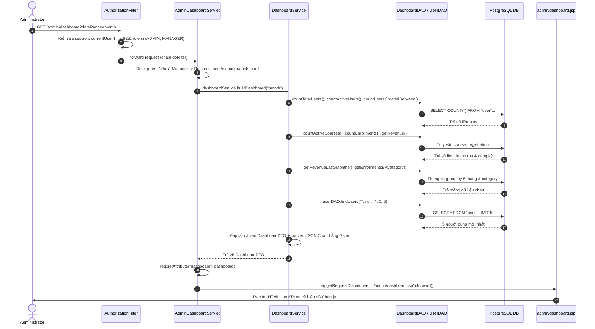
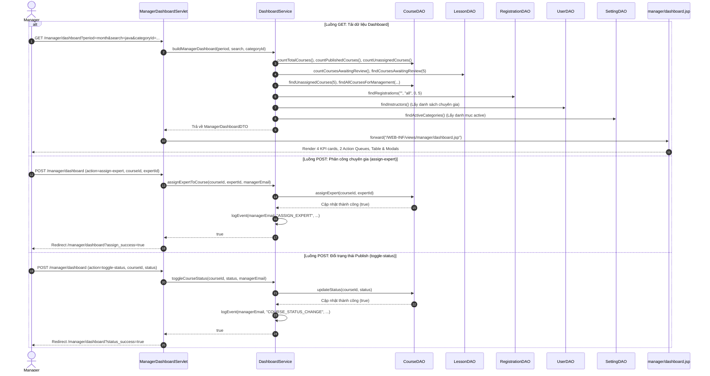

# TÀI LIỆU GIẢI THÍCH CHI TIẾT CƠ CHẾ HOẠT ĐỘNG CÁC MÀN HÌNH HỆ THỐNG
**Dự án: LearnHub (SWP391 - SE2051-NET)**  
**Phạm vi:** Admin Dashboard, Manager Dashboard, Setting List & Setting Details  
**Kiến trúc:** Jakarta EE (Servlet/JSP) + Service + DAO + DTO/Entity + PostgreSQL

---

## MỤC LỤC
1. [Tổng Quan Kiến Trúc Hệ Thống (Architectural Pattern)](#1-tổng-quan-kiến-trúc-hệ-thống)
2. [Màn Hình 1: Admin Dashboard (`/admin/dashboard`)](#2-màn-hình-1-admin-dashboard-admindashboard)
   - [2.1 Luồng tổng quan và Sơ đồ hoạt động](#21-luồng-tổng-quan-và-sơ-đồ-hoạt-động)
   - [2.2 Phân tích chi tiết từng dòng code (Line-by-Line Execution)](#22-phân-tích-chi-tiết-từng-dòng-code-line-by-line-execution)
     - [A. AuthorizationFilter.java](#a-comlearnhubfilterauthorizationfilterjava)
     - [B. AdminDashboardServlet.java](#b-comlearnhubcontrolleradmindashboardservletjava)
     - [C. DashboardService.java (`buildDashboard`)](#c-comlearnhubservicedashboardservicejava---builddashboard)
     - [D. DashboardDAO.java](#d-comlearnhubdaodashboarddaojava)
     - [E. DashboardDTO.java](#e-comlearnhubdtodashboarddtojava)
     - [F. admin/dashboard.jsp & Chart.js](#f-srcmainwebappweb-infviewsadmindashboardjsp)
3. [Màn Hình 2: Manager Dashboard (`/manager/dashboard`)](#3-màn-hình-2-manager-dashboard-managerdashboard)
   - [3.1 Luồng tổng quan (GET & POST)](#31-luồng-tổng-quan-get--post)
   - [3.2 Phân tích chi tiết từng dòng code (Line-by-Line Execution)](#32-phân-tích-chi-tiết-từng-dòng-code-line-by-line-execution-1)
     - [A. ManagerDashboardServlet.java (doGet)](#a-managerdashboardservletjava---phương-thức-doget)
     - [B. ManagerDashboardServlet.java (doPost: assign-expert & toggle-status)](#b-managerdashboardservletjava---phương-thức-dopost)
     - [C. DashboardService.java (`buildManagerDashboard`, `assignExpertToCourse`, `toggleCourseStatus`)](#c-dashboardservicejava---nghiệp-vụ-manager-dashboard)
     - [D. Các DAO liên quan (CourseDAO, LessonDAO, RegistrationDAO)](#d-các-dao-liên-quan-coursedao-lessondao-registrationdao)
     - [E. ManagerDashboardDTO.java](#e-comlearnhubdtomanagerdashboarddtojava)
     - [F. manager/dashboard.jsp (UI Components, Modals & AJAX/Form Submit)](#f-srcmainwebappweb-infviewsmanagerdashboardjsp)
4. [Màn Hình 3: Quản Lý Cấu Hình - Setting List & Details (`/admin/settings`, `/admin/setting-detail`)](#4-màn-hình-3-quản-lý-cấu-hình---setting-list--details)
   - [4.1 Luồng tổng quan (List, Status Toggle, Create/Update Detail)](#41-luồng-tổng-quan)
   - [4.2 Phân tích chi tiết từng dòng code (Line-by-Line Execution)](#42-phân-tích-chi-tiết-từng-dòng-code-line-by-line-execution-2)
     - [A. AdminSettingServlet.java (doGet: List & Show Detail & Get JSON)](#a-adminsettingservletjava---phương-thức-doget)
     - [B. AdminSettingServlet.java (doPost: Change Status & Save Setting)](#b-adminsettingservletjava---phương-thức-dopost)
     - [C. SettingDAO.java (Truy vấn động, Phân trang, Kiểm tra trùng lặp)](#c-comlearnhubdaosettingdaojava)
     - [D. Setting.java (Entity)](#d-comlearnhubentitysettingjava)
     - [E. admin/setting-list.jsp (Giao diện danh sách, Badge, Khóa Role Core)](#e-srcmainwebappweb-infviewsadminsetting-listjsp)
     - [F. admin/setting-detail.jsp (Giao diện Form 2 cột, JS dynamic status)](#f-srcmainwebappweb-infviewsadminsetting-detailjsp)
5. [Cơ Chế Ghi Vết Hệ Thống (Audit Logging)](#5-cơ-chế-ghi-vết-hệ-thống-audit-logging)
6. [Bảng Ma Trận Ánh Xạ Đường Dẫn & Thành Phần (Traceability Matrix)](#6-bảng-ma-trận-ánh-xạ-đường-dẫn--thành-phần-traceability-matrix)

---

## 1. TỔNG QUAN KIẾN TRÚC HỆ THỐNG

LearnHub áp dụng mô hình kiến trúc phân lớp chuẩn doanh nghiệp **MVC 3-Tier Layered Architecture** kết hợp mẫu thiết kế **DAO (Data Access Object)** và **DTO (Data Transfer Object)**:

```mermaid
flowchart TD
    Client["Client Browser\n(HTTP Request)"] --> Filter["Filter Layer\nAuthorizationFilter"]
    Filter --> Controller["Controller Layer\n(Jakarta Servlet)\nAdminDashboardServlet / ManagerDashboardServlet / AdminSettingServlet"]
    Controller --> Service["Service / Business Logic Layer\nDashboardService"]
    Service --> DAO["Data Access Layer\nDashboardDAO / SettingDAO / CourseDAO / LessonDAO / RegistrationDAO / UserDAO"]
    DAO --> DB[("PostgreSQL Database")]
    DAO -. Map ResultSet sang .-> Entity_DTO["Model / Entity / DTO\nSetting, User, Course, Registration, AuditLog\nDashboardDTO, ManagerDashboardDTO"]
    Entity_DTO -. Trả dữ liệu về .-> Service
    Service -. Trả DTO / Entity về .-> Controller
    Controller -. req.setAttribute() & forward() .-> View["Presentation Layer\nJSP + JSTL + Tailwind CSS + Chart.js"]
    View -. HTML/CSS/JS .-> Client
```

### Các lớp chức năng chính:
1. **Filter Layer (`com.learnhub.filter`)**:
   - `AuthorizationFilter`: Can thiệp trước khi request chạm tới Servlet. Thực hiện xác thực đăng nhập (Authentication) và phân quyền vai trò người dùng (Role-Based Access Control - RBAC).
2. **Controller Layer (`com.learnhub.controller`)**:
   - Nhận HTTP Request (GET/POST), trích xuất và kiểm tra tham số đầu vào (query params, form data).
   - Kiểm tra quyền hạn ngữ cảnh cụ thể (Role Guard).
   - Gọi tầng Service/DAO tương ứng.
   - Điều hướng (forward tới JSP hoặc redirect sang URL mới theo mẫu Post-Redirect-Get).
3. **Service Layer (`com.learnhub.service`)**:
   - Chứa nghiệp vụ kinh doanh cốt lõi (Business Logic): tính toán tỷ lệ tăng trưởng kỳ trước - kỳ này, xác định khoảng ngày (`today`, `week`, `month`, `quarter`, `all`), gom dữ liệu cho biểu đồ, ghi log kiểm toán (`audit_log`).
4. **Data Access Layer (`com.learnhub.dao`)**:
   - Trực tiếp tương tác với cơ sở dữ liệu PostgreSQL qua JDBC (`DbConnection`).
   - Sử dụng `PreparedStatement` chống triệt để tấn công SQL Injection.
   - Ánh xạ các dòng kết quả `ResultSet` thành đối tượng Java.
5. **DTO & Entity Layer (`com.learnhub.dto`, `com.learnhub.entity`)**:
   - `Entity`: Đại diện trực tiếp cho các bảng trong CSDL (`setting`, `course`, `user`, `registration`, `audit_log`).
   - `DTO`: Đối tượng chuyển giao dữ liệu được thiết kế riêng cho màn hình, tổng hợp dữ liệu từ nhiều bảng giúp giảm tải số lượng request và tăng hiệu năng hiển thị.
6. **Presentation Layer (`src/main/webapp/WEB-INF/views`)**:
   - Các file JSP bảo mật (đặt trong thư mục `WEB-INF` ngăn truy cập trực tiếp từ client).
   - Dùng JSTL (`c:forEach`, `c:if`, `fmt:formatNumber`, `fn:escapeXml`) và Tailwind CSS để render giao diện hiện đại, responsive.

---

## 2. MÀN HÌNH 1: ADMIN DASHBOARD (`/admin/dashboard`)

### 2.1 Luồng tổng quan và Sơ đồ hoạt động
Màn hình Admin Dashboard cung cấp cái nhìn toàn cảnh về hệ thống cho Quản trị viên cấp cao: Tổng người dùng & Tỷ lệ tăng trưởng, Doanh thu hệ thống theo thời gian (biểu đồ đường Line Chart), Lượt đăng ký khóa học theo danh mục (biểu đồ cột Bar Chart), Trạng thái cài đặt hệ thống và Danh sách người dùng truy cập nhanh (Quick Access Table).



---

### 2.2 Phân tích chi tiết từng dòng code (Line-by-Line Execution)

#### A. `com.learnhub.filter.AuthorizationFilter.java`
- **Dòng 25-29**: Cấu hình bộ lọc `@WebFilter` chặn tất cả các request có tiền tố `/admin/*`, `/manager/*`, `/expert/*`,...
- **Dòng 40-55**:
  - `isLoggedIn(req)`: Đọc session hiện tại, kiểm tra xem thuộc tính `currentUser` có tồn tại không.
  - Nếu `null`: Lưu lại URL đích ban đầu vào tham số `redirect_uri` (đã encode UTF-8 qua `URLEncoder.encode()`) và gọi `resp.sendRedirect(contextPath + "/auth/login?error=unauthorized&redirect_uri=...")`.
- **Dòng 58-93**:
  - `isUnder(path, "/admin")`: Kiểm tra request thuộc nhóm quản trị.
  - Kiểm tra `hasAdminRole(req)`: Đọc mã vai trò (`roleCode` hoặc `userRole` trong session). Nếu người dùng không có vai trò `ROLE_ADMIN` hoặc `ROLE_MANAGER`, gọi `resp.sendError(HttpServletResponse.SC_FORBIDDEN)` (mã HTTP 403 - Cấm truy cập).
- **Dòng 121**: Khi hợp lệ, gọi `chain.doFilter(request, response)` để chuyển tiếp request đến `AdminDashboardServlet`.

---

#### B. `com.learnhub.controller.AdminDashboardServlet.java`
- **Dòng 26**: Annotation `@WebServlet(name = "AdminDashboardServlet", urlPatterns = {"/admin/dashboard"})` ánh xạ Servlet với URL `/admin/dashboard`.
- **Dòng 29**: `private final DashboardService dashboardService = new DashboardService();` khởi tạo tầng nghiệp vụ xử lý dữ liệu bảng điều khiển.
- **Dòng 32-34**: Bắt đầu phương thức `doGet(HttpServletRequest req, HttpServletResponse resp)`.
- **Dòng 36-40**:
  - `HttpSession session = req.getSession(false);` lấy session hiện hành (không tạo session mới nếu chưa có).
  - Kiểm tra an toàn kép nếu session rỗng hoặc không có `currentUser` -> chuyển hướng về trang login.
- **Dòng 42-56**:
  - Lấy thông tin đối tượng `User` hiện tại và chuỗi `userRole`.
  - Kiểm tra logic phân bổ giao diện: Nếu người dùng thực chất là **Manager** (vào nhầm link Admin), hệ thống tự động redirect sang `/manager/dashboard` bằng `resp.sendRedirect(req.getContextPath() + "/manager/dashboard")`.
- **Dòng 58-68**:
  - Kiểm tra tính xác thực của Admin (`ROLE_ADMIN`, `admin`, `Administrator`).
  - Nếu không phải Admin -> trả về lỗi `SC_FORBIDDEN` (HTTP 403).
- **Dòng 71-74**:
  - Đọc tham số lọc thời gian: `String dateRange = req.getParameter("dateRange");`.
  - Nếu không truyền hoặc truyền chuỗi rỗng: Mặc định gán `dateRange = "month"`.
- **Dòng 77**:
  - `DashboardDTO dashboard = dashboardService.buildDashboard(dateRange);`
  - Đây là lệnh triệu gọi cốt lõi sang Service để thu thập toàn bộ dữ liệu chỉ số.
- **Dòng 80-82**:
  - `req.setAttribute("dashboard", dashboard);` đóng gói DTO vào phạm vi request.
  - `req.setAttribute("pageTitle", "Admin Dashboard – LearnHub");` gán tiêu đề trang.
  - `req.getRequestDispatcher("/WEB-INF/views/admin/dashboard.jsp").forward(req, resp);` chuyển tiếp nội bộ sang view JSP để hiển thị.

---

#### C. `com.learnhub.service.DashboardService.java` - `buildDashboard()`
- **Dòng 70-74**: Nhận `dateRange`, khởi tạo đối tượng rỗng `DashboardDTO dto = new DashboardDTO();` và gán `dto.setDateRange(dateRange)`.
- **Dòng 78-105: Tính toán cửa sổ thời gian (Current Window vs Previous Window)**:
  - Sử dụng `LocalDate today = LocalDate.now();`.
  - Phân nhánh `switch (dateRange)`:
    - `"today"`: Kỳ hiện tại từ 00:00:00 hôm nay đến 23:59:59 hôm nay. Kỳ đối chiếu là ngày hôm qua (`today.minusDays(1)`).
    - `"week"`: Kỳ hiện tại là 7 ngày gần nhất (`today.minusDays(6)` đến hiện tại). Kỳ đối chiếu là 7 ngày trước đó.
    - Mặc định `"month"`: Kỳ hiện tại tính từ ngày 1 đầu tháng (`today.withDayOfMonth(1)`) đến hiện tại. Kỳ trước tính từ ngày 1 của tháng trước (`today.minusMonths(1).withDayOfMonth(1)`) đến ngày 1 của tháng này.
- **Dòng 109-117: Tính toán người dùng**:
  - `int totalUsers = dashboardDAO.countTotalUsers();`: Tổng số tài khoản trên hệ thống.
  - `int activeUsers = dashboardDAO.countActiveUsers();`: Số tài khoản đang hoạt động.
  - Đếm số user tạo mới trong kỳ này (`currentNewUsers`) và kỳ trước (`previousNewUsers`).
  - Gọi hàm trợ giúp `growthPct(currentNewUsers, previousNewUsers)` (dòng 292-296): Tính công thức `((current - previous) / previous) * 100`, làm tròn 1 chữ số thập phân (`RoundingMode.HALF_UP`).
- **Dòng 120**: `dashboardDAO.countActiveCourses()` đếm các khóa học đã được xuất bản (`status = 'published'`).
- **Dòng 124-128**:
  - `dashboardDAO.countEnrollments(currentFrom, currentTo)` tính số lượt ghi danh trong kỳ.
  - `dashboardDAO.countTotalEnrollments()` đếm tổng số ghi danh mọi thời đại.
  - Tính % tăng trưởng lượt ghi danh so với kỳ trước.
- **Dòng 131-133**:
  - `dashboardDAO.getRevenue(currentFrom, currentTo)` truy vấn tổng tiền các đơn thanh toán thành công (`payment_status = 'paid'`).
- **Dòng 136-137**:
  - `dashboardDAO.countPendingRegistrations()` đếm số đơn đăng ký chưa thanh toán (`payment_status = 'pending'`).
- **Dòng 140-142**:
  - `dashboardDAO.getRecentAuditLogs(10)` lấy 10 bản ghi lịch sử hoạt động mới nhất.
- **Dòng 145-158: Dữ liệu đồ thị (Charts Data)**:
  - `dashboardDAO.getRevenueLast6Months()` trả về mảng gồm: Nhãn 6 tháng gần nhất (`revLabels`) và doanh thu tương ứng (`revValues`).
  - `dashboardDAO.getEnrollmentsByCategory()` trả về top 5 danh mục có lượt đăng ký cao nhất.
  - Sử dụng thư viện `com.google.gson.Gson` để chuyển đối tượng Java `List<String>` và `List<BigDecimal>` thành định dạng chuỗi JSON:
    ```java
    Gson gson = new Gson();
    dto.setRevenueLabelsJson(gson.toJson(revLabels));
    dto.setRevenueDataJson(gson.toJson(revValues));
    dto.setEnrollmentLabelsJson(gson.toJson(enrLabels));
    dto.setEnrollmentDataJson(gson.toJson(enrValues));
    ```
- **Dòng 160-161**:
  - `userDAO.findUsers("", null, "", 0, 5)` lấy 5 tài khoản người dùng mới tạo gần nhất phục vụ danh sách truy cập nhanh (Quick Access).
- **Dòng 163**: `return dto;` trả DTO đã nạp đầy đủ dữ liệu về cho Servlet.

---

#### D. `com.learnhub.dao.DashboardDAO.java`
- **Dòng 35-38 (`countTotalUsers`)**:
  - Thực thi: `SELECT COUNT(*) FROM "user"`.
  - Sử dụng `querySingleInt()` (dòng 250-258): Mở kết nối qua `DbConnection.getConnection()`, tạo `PreparedStatement`, lấy cột `rs.getInt(1)`.
- **Dòng 43-46 (`countActiveUsers`)**:
  - Thực thi: `SELECT COUNT(*) FROM "user" WHERE status = 'active'`.
- **Dòng 51-64 (`countUsersCreatedBetween`)**:
  - Thực thi: `SELECT COUNT(*) FROM "user" WHERE created_at >= ? AND created_at < ?`.
  - Dùng `ps.setTimestamp(1, from)` và `ps.setTimestamp(2, to)` để lọc chính xác thời điểm.
- **Dòng 71-74 (`countActiveCourses`)**:
  - Thực thi: `SELECT COUNT(*) FROM course WHERE status = 'published'`.
- **Dòng 84-97 (`countEnrollments`)**:
  - Thực thi: `SELECT COUNT(*) FROM registration WHERE enrolled_at >= ? AND enrolled_at < ?`.
- **Dòng 122-136 (`getRevenue`)**:
  - Thực thi: `SELECT COALESCE(SUM(amount), 0) FROM registration WHERE payment_status = 'paid' AND paid_at >= ? AND paid_at < ?`.
  - Hàm `COALESCE` đảm bảo nếu không có đơn nào thì CSDL trả về 0 thay vì `NULL`.
- **Dòng 160-181 (`getRevenueLast6Months`)**:
  - Thực thi SQL trích xuất theo tháng:
    ```sql
    SELECT TO_CHAR(registration_date, 'Mon') as month_label, SUM(amount) as revenue
    FROM registration
    WHERE payment_status = 'paid'
      AND registration_date >= date_trunc('month', CURRENT_DATE - INTERVAL '5 months')
    GROUP BY TO_CHAR(registration_date, 'Mon'), date_trunc('month', registration_date)
    ORDER BY date_trunc('month', registration_date)
    ```
- **Dòng 187-208 (`getEnrollmentsByCategory`)**:
  - Thực thi câu lệnh JOIN 3 bảng: `registration` JOIN `course` JOIN `setting` (lấy tên category từ cột `setting.value`):
    ```sql
    SELECT s.value as category_name, COUNT(r.id) as enrollments
    FROM registration r
    JOIN course c ON r.course_id = c.id
    JOIN setting s ON c.category_id = s.id
    GROUP BY s.value
    ORDER BY enrollments DESC
    LIMIT 5
    ```

---

#### E. `com.learnhub.dto.DashboardDTO.java`
- Chứa các trường dữ liệu tổng hợp:
  - `totalUsers`, `activeUsers`, `userGrowthPct` (Số liệu người dùng & % tăng trưởng).
  - `activeCourses` (Khóa học hoạt động).
  - `totalEnrollments`, `enrollmentGrowthPct` (Lượt ghi danh & % tăng trưởng).
  - `monthlyRevenue` (Doanh thu dạng `BigDecimal` tránh sai số tiền tệ).
  - `pendingRegistrations` (Đơn đăng ký chờ duyệt/thanh toán).
  - `revenueLabelsJson`, `revenueDataJson`, `enrollmentLabelsJson`, `enrollmentDataJson` (Chuỗi JSON cấp cho Chart.js).
  - `recentUsers` (`List<User>` cho Quick Access Table).

---

#### F. `src/main/webapp/WEB-INF/views/admin/dashboard.jsp`
- **Dòng 5-6**: Nạp các fragment dùng chung: `<jsp:include page="/WEB-INF/views/common/header.jsp" />` và `navbar.jsp`.
- **Dòng 27-38 (Card Total Users)**:
  - Hiển thị giá trị `${dashboard.totalUsers}` được định dạng số nguyên qua `<fmt:formatNumber value="${...}" type="number"/>`.
  - Badge phần trăm tăng trưởng: `+${dashboard.userGrowthPct}%`.
- **Dòng 40-51 (Card System Setting)**:
  - Hiển thị tình trạng hệ thống ("Stable") kèm nút "Modify" liên kết trực tiếp tới `${pageContext.request.contextPath}/admin/settings`.
- **Dòng 55-88 (Hai khung đồ thị Chart.js)**:
  - Định nghĩa 2 thẻ HTML Canvas: `<canvas id="revenueChart"></canvas>` và `<canvas id="enrollmentChart"></canvas>`.
  - Hiển thị tổng doanh thu và tổng lượt ghi danh trên đầu card.
- **Dòng 102-150 (Quick Access User Table)**:
  - Sử dụng thẻ `<c:forEach var="u" items="${dashboard.recentUsers}">` duyệt qua 5 user mới nhất.
  - Hiển thị avatar chữ cái đầu (`${fn:substring(u.username, 0, 1)}`), tên tài khoản, email, nhãn vai trò (`u.roleName`) và trạng thái (`Active` màu xanh, các trạng thái khác màu đỏ/xám).
  - Dưới bảng có nút bấm chuyển tới toàn bộ danh sách: `/admin/users`.
- **Dòng 159-219 (Kịch bản JavaScript dựng biểu đồ)**:
  - Lắng nghe sự kiện `document.addEventListener('DOMContentLoaded', ...)`.
  - Đọc dữ liệu JSON được nhúng trực tiếp từ DTO:
    `labels: ${dashboard.revenueLabelsJson != null ? dashboard.revenueLabelsJson : "[]"}`
    `data: ${dashboard.revenueDataJson != null ? dashboard.revenueDataJson : "[]"}`
  - Khởi tạo đối tượng `new Chart(ctxRev, { type: 'line', ... })` vẽ đường cong doanh thu và `new Chart(ctxEnr, { type: 'bar', ... })` vẽ cột ghi danh theo thể loại.

---

## 3. MÀN HÌNH 2: MANAGER DASHBOARD (`/manager/dashboard`)

### 3.1 Luồng tổng quan (GET & POST)
Màn hình Manager Dashboard dành riêng cho Quản lý đào tạo (Manager) nhằm điều phối chất lượng giảng dạy và xuất bản nội dung:
- **Luồng GET**: Thống kê 4 thẻ chỉ số KPI; 2 hàng đợi công việc khẩn cấp (Hàng đợi bài học cần duyệt - Curriculum Reviews Queue & Hàng đợi khóa học chưa có giảng viên phụ trách - Unassigned Courses Queue); Bảng danh mục khóa học (Course Catalog) kèm công tắc bật/tắt Publish trực tiếp; Dòng thời gian hiển thị học viên đăng ký học thời gian thực (Recent Student Enrollments Log Feed).
- **Luồng POST**: Thực hiện 2 hành vi thay đổi dữ liệu:
  1. `assign-expert`: Gán hoặc hủy gán chuyên gia môn học (Subject Expert) cho một khóa học.
  2. `toggle-status`: Chuyển đổi trạng thái khóa học giữa `draft` (bản nháp) và `published` (công khai).



---

### 3.2 Phân tích chi tiết từng dòng code (Line-by-Line Execution)

#### A. `ManagerDashboardServlet.java` - Phương thức `doGet`
- **Dòng 26**: `@WebServlet(name = "ManagerDashboardServlet", urlPatterns = {"/manager/dashboard"})`.
- **Dòng 33**: Bắt đầu phương thức `doGet`.
- **Dòng 34-43**:
  - Lấy session và `currentUser`. Nếu chưa đăng nhập, lưu lại toàn bộ URI kèm query string (`redirectUri += "?" + req.getQueryString()`), encode URL và chuyển hướng người dùng đến trang đăng nhập.
- **Dòng 45-48**:
  - Gọi hàm `isAuthorizedManager(req, currentUser)` (dòng 149-163): Kiểm tra vai trò của người dùng có thuộc nhóm Manager (`ROLE_MANAGER`, `manager`, `Manager`) hoặc Quản trị viên (`ROLE_ADMIN`, `admin`) hay không.
  - Nếu không đúng vai trò: Gửi mã lỗi HTTP 403 Forbidden kèm thông điệp `"Access denied: Manager privileges required."`.
- **Dòng 50-60: Xử lý bộ lọc tham số**:
  - `String period = req.getParameter("period");`: Nếu rỗng thì thử đọc `dateRange`; nếu vẫn rỗng thì mặc định `"month"`.
  - `String search = req.getParameter("search");`: Từ khóa tìm kiếm khóa học theo tiêu đề hoặc mã khóa học.
  - `String categoryId = req.getParameter("categoryId");`: Mã UUID của danh mục lọc.
- **Dòng 63**:
  - `ManagerDashboardDTO dashboard = dashboardService.buildManagerDashboard(period, search, categoryId);`: Gọi tầng Service tổng hợp toàn bộ dữ liệu.
- **Dòng 65-77: Xử lý thông điệp phản hồi (Flash Feedback)**:
  - Kiểm tra các query parameter trả về từ các thao tác trước:
    - `assign_success=true`: Gán `req.setAttribute("successMessage", "Domain expert has been assigned successfully!")`.
    - `status_success=true`: Gán `req.setAttribute("successMessage", "Course publication status updated successfully!")`.
    - `error=assign_failed`: Gán `errorMessage` tương ứng.
- **Dòng 79**: Forward toàn bộ dữ liệu sang `/WEB-INF/views/manager/dashboard.jsp`.

---

#### B. `ManagerDashboardServlet.java` - Phương thức `doPost`
- **Dòng 83-94**:
  - Kiểm tra đăng nhập và quyền hạn tương tự `doGet`. Nếu không hợp lệ -> chặn ngay lập tức.
- **Dòng 96-98**:
  - Đọc tham số `action` và `period` (nhằm giữ nguyên trạng thái bộ lọc sau khi chuyển hướng).
- **Dòng 100-106: Phân phối hành động**:
  - Nếu `action == "assign-expert"`: Gọi hàm xử lý riêng `handleAssignExpert(...)`.
  - Nếu `action == "toggle-status"`: Gọi hàm xử lý riêng `handleToggleStatus(...)`.
- **Dòng 109-128 (`handleAssignExpert`)**:
  - Đọc `courseIdStr` và `expertIdStr`.
  - Chuyển đổi an toàn sang `UUID.fromString()`. Nếu `expertIdStr` rỗng -> gán `null` (nghĩa là hủy phân công chuyên gia).
  - Gọi `dashboardService.assignExpertToCourse(courseId, expertId, actor.getEmail())`.
  - Nếu thành công: Gọi `resp.sendRedirect(req.getContextPath() + "/manager/dashboard?assign_success=true" + periodParam)` (Áp dụng mẫu Post-Redirect-Get để tránh việc người dùng F5 bị gửi lại form).
- **Dòng 130-147 (`handleToggleStatus`)**:
  - Đọc `courseIdStr` và `status` (chuỗi `'published'` hoặc `'draft'`).
  - Gọi `dashboardService.toggleCourseStatus(courseId, status.trim().toLowerCase(), actor.getEmail())`.
  - Nếu thành công: Redirect về `/manager/dashboard?status_success=true`.

---

#### C. `DashboardService.java` - Nghiệp vụ Manager Dashboard
- **Dòng 184-215 (`buildManagerDashboard`)**:
  - Xác định mốc thời gian: `"quarter"` (lùi 3 tháng), `"all"` (từ năm 2000), `"month"` (từ ngày 1 đầu tháng).
- **Dòng 217-236: Tính 4 thẻ KPI**:
  - `courseDAO.countTotalCourses()`: Tổng số khóa học.
  - `courseDAO.countPublishedCourses()`: Số khóa học đang mở công khai.
  - `courseDAO.countUnpublishedCourses()`: Số khóa học bản nháp.
  - `lessonDAO.countCoursesAwaitingReview()`: Số lượng khóa học có bài học đang chờ Quản lý duyệt nội dung.
  - `courseDAO.countUnassignedCourses()`: Số lượng khóa học chưa có chuyên gia quản lý.
  - `dashboardDAO.countTotalEnrollments()` & `countEnrollments()`: Tính lượt ghi danh và % tăng trưởng qua `growthPct()`.
- **Dòng 237-240: Lấy 2 hàng đợi công việc**:
  - `lessonDAO.findCoursesAwaitingReview(5)`: Lấy top 5 khóa học có số bài học đang ở trạng thái `pending_review` lớn nhất.
  - `courseDAO.findUnassignedCourses(5)`: Lấy top 5 khóa học mới tạo chưa được gán chuyên gia (`expert_id IS NULL`).
- **Dòng 242-251: Bảng danh mục khóa học (Course Catalog Preview)**:
  - Chuyển `categoryIdStr` thành UUID (nếu hợp lệ).
  - Gọi `courseDAO.findAllCoursesForManagement(search, catId, null, null, "created_at", "desc", 0, 10)`: Lấy 10 khóa học đầu tiên theo tiêu chí tìm kiếm và lọc danh mục.
  - Gọi `courseDAO.countAllCoursesForManagement(...)` để đếm tổng số khóa học khớp điều kiện.
- **Dòng 254: Dòng thời gian ghi danh**:
  - `registrationDAO.findRegistrations("", "all", 0, 5)`: Lấy 5 đơn ghi danh mới nhất thời gian thực.
- **Dòng 258-259: Danh sách tra cứu (Lookups)**:
  - `userDAO.findInstructors()`: Lấy danh sách tài khoản có vai trò Chuyên gia/Giảng viên để nạp vào thẻ `<select>` của Modal phân công.
  - `settingDAO.findActiveCategories()`: Lấy danh mục khóa học hoạt động (`type = 'category' AND status = TRUE`) nạp vào dropdown lọc danh mục.
- **Dòng 264-273 (`assignExpertToCourse`)**:
  - Gọi `courseDAO.assignExpert(courseId, expertId)`.
  - Nếu thành công, truy vấn tên khóa học và gọi `logEvent(managerEmail, "ASSIGN_EXPERT", "Assigned expert to course: " + title, "SUCCESS")` để lưu vào bảng `audit_log`.
- **Dòng 275-284 (`toggleCourseStatus`)**:
  - Gọi `courseDAO.updateStatus(courseId, newStatus)`.
  - Tự động ghi vết kiểm toán vào `audit_log`.

---

#### D. Các DAO liên quan (`CourseDAO`, `LessonDAO`, `RegistrationDAO`)
- **`CourseDAO.java:479-486` (`countUnassignedCourses`)**:
  - Câu lệnh SQL: `SELECT COUNT(*) FROM course WHERE expert_id IS NULL`.
- **`CourseDAO.java:516-524` (`assignExpert`)**:
  - Câu lệnh SQL: `UPDATE course SET expert_id = ?, updated_at = NOW() WHERE id = ?`.
  - Nếu `expertId == null`: dùng `ps.setNull(1, Types.OTHER)`.
- **`CourseDAO.java:364-372` (`updateStatus`)**:
  - Câu lệnh SQL: `UPDATE course SET status = ?, updated_at = NOW() WHERE id = ?`.
- **`LessonDAO.java:297-306` (`countCoursesAwaitingReview`)**:
  - Câu lệnh SQL:
    ```sql
    SELECT COUNT(DISTINCT course_id) FROM lesson WHERE status = 'pending_review'
    ```
- **`LessonDAO.java:311-338` (`findCoursesAwaitingReview`)**:
  - Câu lệnh SQL gom nhóm lấy khóa học, tên danh mục, tên chuyên gia và số bài học chờ duyệt:
    ```sql
    SELECT c.id AS course_id, c.title AS course_title, s.name AS category_name,
           u.username AS expert_name, COUNT(l.id) AS pending_lesson_count
    FROM lesson l
    JOIN course c ON l.course_id = c.id
    LEFT JOIN setting s ON c.category_id = s.id
    LEFT JOIN "user" u ON c.expert_id = u.id
    WHERE l.status = 'pending_review'
    GROUP BY c.id, c.title, s.name, u.username
    ORDER BY pending_lesson_count DESC
    LIMIT ?
    ```
  - Ánh xạ trực tiếp vào danh sách DTO con: `ManagerDashboardDTO.PendingReviewItem`.

---

#### E. `com.learnhub.dto.ManagerDashboardDTO.java`
- Đóng gói dữ liệu hiển thị toàn diện:
  - 4 KPI cards: `totalCourses`, `publishedCourses`, `unpublishedCourses`, `pendingReviewsCount`, `unassignedCoursesCount`, `totalEnrollments`, `enrollmentGrowthPct`.
  - Trạng thái bộ lọc: `dateRange`, `search`, `selectedCategory`.
  - Hàng đợi hành động: `List<PendingReviewItem> pendingReviews` và `List<Course> unassignedCourses`.
  - Dữ liệu bảng: `List<Course> courses` và `totalCatalogCourses`.
  - Dòng sự kiện thời gian thực: `List<Registration> recentEnrollments`.
  - Danh sách chọn: `List<User> instructors` và `List<Setting> categories`.

---

#### F. `src/main/webapp/WEB-INF/views/manager/dashboard.jsp`
- **Dòng 11-28**: Hiển thị hộp thông báo lỗi (`errorMessage`) hoặc thành công (`successMessage`) có nút đóng (X).
- **Dòng 58-105 (Filter Bar)**: Form GET gửi trực tiếp các tham số `search`, `period` và `categoryId` kèm nút "Filter" và nút "Reset" nhanh khi có bộ lọc hoạt động.
- **Dòng 108-218 (4 Metric KPI Cards)**:
  - Card 1: Tổng khóa học (có phân rã số lượng Published màu xanh và Unpublished màu vàng).
  - Card 2: Khóa học chờ duyệt bài (hiển thị nhãn cảnh báo "Needs Review" màu cam nếu count > 0).
  - Card 3: Khóa học thiếu giảng viên (hiển thị nhãn "Pending Allocation" màu đỏ nếu count > 0).
  - Card 4: Tổng lượt đăng ký học kèm biểu tượng mũi tên tăng giảm % so với kỳ trước.
- **Dòng 221-310 (2 Action Queues)**:
  - Queue 1: Hiển thị tên khóa học, giảng viên phụ trách, số lượng bài học chờ duyệt kèm nút **"Review"** dẫn sang `/admin/lesson-review?courseId=...`.
  - Queue 2: Hiển thị khóa học thiếu giảng viên kèm nút bấm **"Assign Expert"** kích hoạt hàm JS `openAssignExpertModal(courseId, title, '')`.
- **Dòng 314-432 (Course Catalog Table)**:
  - Bảng danh sách khóa học hiển thị: Tiêu đề, Mã định danh thu gọn 8 ký tự (`#${fn:substring(c.id.toString(), 0, 8)}`), Danh mục, Chuyên gia phụ trách, Tổng học viên.
  - Cột Publish Status tích hợp **Công tắc Toggle trực tiếp**:
    Form POST gửi `action=toggle-status`, `courseId` và trạng thái đảo ngược (`c.status eq 'published' ? 'draft' : 'published'`). Nút bấm được thiết kế như công tắc gạt iOS với hiệu ứng chuyển động mượt mà.
- **Dòng 434-482 (Recent Student Enrollments Log Feed)**:
  - Hiển thị danh sách học viên đăng ký mới nhất: Tên học viên, Khóa học đăng ký, Trạng thái thanh toán, Số tiền đã trả (định dạng ₫), Mã giao dịch ngân hàng và thời gian ghi danh chính xác đến từng phút (`dd/MM/yyyy HH:mm`).
- **Dòng 488-533 (Modal: Assign Domain Expert)**:
  - Hộp thoại bật lên (Popup Modal) có nền mờ `backdrop-blur-xs`.
  - Chứa Form POST gửi `action=assign-expert`. Có dropdown chọn danh sách các chuyên gia (`dashboard.instructors`) hoặc chọn `-- No Expert Assigned (Unassign) --`.
- **Dòng 538-620 (Modal: Quick Create Course)**:
  - Modal tạo nhanh khóa học mới gồm các trường: Tiêu đề, Danh mục (Category), Chuyên gia phụ trách, Giá tiền (Price) và Trạng thái ban đầu (Draft/Published). Gửi POST tới `/admin/courses`.
- **Dòng 622-652 (Kịch bản JS điều khiển Modal)**:
  - `openAssignExpertModal(courseId, title, expertId)`: Điền giá trị khóa học vào Form và gỡ bỏ class `hidden`.
  - Tự động đóng modal khi người dùng bấm phím ra ngoài vùng nền mờ `click`.

---

## 4. MÀN HÌNH 3: QUẢN LÝ CẤU HÌNH - SETTING LIST & DETAILS

### 4.1 Luồng tổng quan
Module Quản lý Cấu hình Hệ thống (System Settings / Master Data Management) theo đặc tả SRS 2.2 / 2.2.1 quản lý toàn bộ các dữ liệu nền tảng của hệ thống: Vai trò (`role`), Danh mục khóa học (`category`), Trạng thái và các cấu hình chung.
1. **Setting List (`/admin/settings`)**:
   - Hiển thị bảng dữ liệu có phân trang (10 mục/trang).
   - Tìm kiếm đa năng theo Tên cấu hình (`name`), Mã cấu hình (`code`) hoặc Mô tả (`description`).
   - Lọc theo Loại cấu hình (`type`) và Trạng thái (`status`: active / inactive).
   - Sắp xếp linh hoạt theo Tên, Mã, Loại, Thứ tự hiển thị (`sort_order`), Ngày tạo.
   - Bật/tắt trạng thái trực tiếp: Có hộp thoại xác nhận JavaScript; **Đặc biệt: Khóa cứng các vai trò cốt lõi (Core Roles) không bao giờ được phép tắt Active**.
2. **Setting Detail / Add New (`/admin/setting-detail`)**:
   - Nếu có `id`: Tải dữ liệu để chỉnh sửa (Edit Mode).
   - Nếu không có `id`: Mở form thêm mới (Create Mode).
   - Tự động sinh mã Code chuẩn hóa (`generateSettingCode`) nếu người dùng để trống mã Code.
   - Validate tính duy nhất của Tên cấu hình (`existsByName`).
   - Giao diện Form thông minh: Khi chọn loại `type = role`, tùy chọn Inactive tự động ẩn đi và khóa cứng ở trạng thái Active.

```mermaid
sequenceDiagram
    autonumber
    actor Admin as Admin / Manager
    participant Servlet as AdminSettingServlet
    participant DAO as SettingDAO
    participant Service as DashboardService
    participant DB as PostgreSQL DB
    participant ListJSP as admin/setting-list.jsp
    participant DetailJSP as admin/setting-detail.jsp

    alt Case 1: Xem danh sách Setting (GET /admin/settings)
        Admin->>Servlet: GET /admin/settings?search=...&type=...&page=1
        Servlet->>DAO: findSettings(search, type, status, sortBy, sortOrder, offset, 10)
        DAO->>DB: SELECT * FROM setting WHERE ... ORDER BY ... LIMIT 10 OFFSET 0
        DB-->>DAO: Trả về List<Setting>
        Servlet->>DAO: countSettings(...), findAllTypes()
        DAO-->>Servlet: Trả tổng số bản ghi và danh sách loại cấu hình
        Servlet->>ListJSP: forward(settings, types, totalPages, currentPage)
        ListJSP-->>Admin: Hiển thị bảng cấu hình + phân trang + bộ lọc
    else Case 2: Bật/tắt trạng thái (POST /admin/setting-status)
        Admin->>Servlet: POST /admin/setting-status (id, status=false)
        Servlet->>DAO: findById(id)
        Servlet->>Servlet: isProtectedCoreSetting(setting): Nếu là Role -> CHẶN
        Servlet->>DAO: updateStatus(id, newStatus)
        DAO->>DB: UPDATE setting SET status = ?, updated_at = NOW() WHERE id = ?
        Servlet->>Service: logEvent(actor, "SETTING_STATUS_CHANGE", ...)
        Servlet-->>Admin: Redirect /admin/settings?status_success=true
    else Case 3: Thêm mới / Cập nhật (POST /admin/setting-detail)
        Admin->>Servlet: POST /admin/setting-detail (id, type, code, name, description, status, sortOrder)
        Servlet->>Servlet: Kiểm tra rỗng name, type; Tự sinh code nếu trống
        Servlet->>DAO: existsByName(name, currentId)
        alt Tên đã tồn tại
            DAO-->>Servlet: true
            Servlet->>DetailJSP: forward kèm errorMessage ("Setting Name already exists")
        else Tên hợp lệ
            alt Là Cập nhật (Update)
                Servlet->>DAO: update(setting)
                Servlet->>Service: logEvent(actor, "SETTING_UPDATE", ...)
            else Là Thêm mới (Insert)
                Servlet->>DAO: insert(setting với UUID ngẫu nhiên)
                Servlet->>Service: logEvent(actor, "SETTING_CREATE", ...)
            end
            Servlet-->>Admin: Redirect /admin/settings?save_success=true
        end
    end
```

---

### 4.2 Phân tích chi tiết từng dòng code (Line-by-Line Execution)

#### A. `AdminSettingServlet.java` - Phương thức `doGet`
- **Dòng 33**: Ánh xạ 3 URL cùng lúc:
  `@WebServlet(name = "AdminSettingServlet", urlPatterns = {"/admin/settings", "/admin/setting-detail", "/admin/setting-status"})`.
- **Dòng 37-38**: Khởi tạo `SettingDAO` và `DashboardService`.
- **Dòng 42-57**:
  - Kiểm tra session đăng nhập và gọi hàm `isAuthorizedAdmin(currentUser, role)` (dòng 410-425).
  - Cho phép cả `Admin` và `Manager` quản lý cấu hình.
- **Dòng 59-63: Rẽ nhánh hiển thị chi tiết**:
  - Kiểm tra `String path = req.getServletPath();`.
  - Nếu `path.equals("/admin/setting-detail")`: Chuyển quyền xử lý cho `handleShowDetail(req, resp)` và kết thúc `doGet`.
- **Dòng 65-69: Rẽ nhánh lấy JSON qua AJAX**:
  - Nếu `action == "get-json"`: Gọi `handleGetJson(req, resp)` trả chuỗi JSON cấu hình cho client.
- **Dòng 71-94: Xử lý bộ lọc và phân trang danh sách**:
  - Đọc các tham số: `search`, `type`, `status`, `sortBy`, `sortOrder`, `pageStr`.
  - Mặc định sắp xếp: `sortBy = "order"` (theo thứ tự hiển thị `sort_order`), `sortOrder = "asc"`.
  - Mặc định phân trang: `page = 1`, kích thước trang `pageSize = 10`.
  - Tính vị trí bắt đầu trong CSDL: `int offset = (page - 1) * pageSize;`.
- **Dòng 96-98: Truy vấn CSDL**:
  - `List<Setting> settings = settingDAO.findSettings(search, type, status, sortBy, sortOrder, offset, pageSize);`
  - `int totalSettings = settingDAO.countSettings(search, type, status);`
  - Tính tổng số trang: `int totalPages = (int) Math.ceil((double) totalSettings / pageSize);`.
- **Dòng 100**:
  - `List<String> types = settingDAO.findAllTypes();`: Lấy toàn bộ các giá trị `type` khác nhau đang có trong CSDL để nạp vào dropdown bộ lọc.
- **Dòng 102-123**:
  - Đẩy toàn bộ dữ liệu vào `req.setAttribute(...)`.
  - Đọc thông báo phản hồi từ redirect: `status_success`, `save_success`, `core_role_protected`.
  - `req.getRequestDispatcher("/WEB-INF/views/admin/setting-list.jsp").forward(req, resp);` hiển thị trang danh sách.

##### Phương thức `handleShowDetail(HttpServletRequest req, HttpServletResponse resp)` (Dòng 143-165):
- Đọc tham số `id`: `String idStr = req.getParameter("id");`.
- Nếu có `id`: Parse sang UUID và gọi `settingDAO.findById(id)`. Nếu không tìm thấy, redirect về trang danh sách.
- Gọi hàm `isProtectedCoreSetting(setting)` (dòng 136-141): Kiểm tra xem setting có thuộc nhóm vai trò hệ thống (`type = "role"`) hay không.
- Gọi hàm `getSettingTypes(setting)` (dòng 167-183): Trả về danh sách types gồm các loại hiện có cộng thêm loại của chính setting đó nếu chưa xuất hiện.
- Forward dữ liệu sang `/WEB-INF/views/admin/setting-detail.jsp`.

---

#### B. `AdminSettingServlet.java` - Phương thức `doPost`
- **Dòng 186-210**:
  - Kiểm tra session đăng nhập và quyền hạn Admin/Manager.
  - Phân nhánh hành vi:
    - Nếu `path.equals("/admin/setting-status")` hoặc `action == "status"`: Gọi `handleChangeStatus(req, resp, currentUser)`.
    - Nếu `path.equals("/admin/setting-detail")` hoặc `action == "save"`: Gọi `handleSaveSetting(req, resp, currentUser)`.

##### Phương thức `handleChangeStatus(...)` (Dòng 212-243):
- Đọc `idStr` và chuỗi boolean `statusStr`.
- Chuyển đổi sang `UUID id` và `boolean newStatus = Boolean.parseBoolean(statusStr.trim())`.
- Tìm kiếm setting: `Setting setting = settingDAO.findById(id)`.
- **Cơ chế bảo vệ Role cốt lõi (Core Role Protection)**:
  ```java
  if (isProtectedCoreSetting(setting) && !newStatus) {
      resp.sendRedirect(req.getContextPath() + "/admin/settings?error=core_role_protected");
      return;
  }
  ```
  Nếu ai đó cố tình vô hiệu hóa một Role (chuyển sang `Inactive`), hệ thống sẽ lập tức chặn lại và cảnh báo lỗi.
- Gọi `settingDAO.updateStatus(id, newStatus)`.
- Ghi log kiểm toán:
  `dashboardService.logEvent(actor.getEmail(), "SETTING_STATUS_CHANGE", "Đổi trạng thái cấu hình '" + setting.getName() + "' sang: " + (newStatus ? "Active" : "Inactive"), "SUCCESS");`
- Redirect về `/admin/settings?status_success=true`.

##### Phương thức `handleSaveSetting(...)` (Dòng 245-351):
- Đọc toàn bộ các trường từ form submit: `id`, `type`, `code`, `name`, `description`, `status`, `sortOrder`.
- Xác định xem đây là thao tác Tạo mới (`isUpdate = false`) hay Chỉnh sửa (`isUpdate = true`).
- Nếu cấu hình là `type = "role"`: Luôn luôn ép buộc `status = true`.
- **Tự động sinh mã Code chuẩn hóa nếu để trống (`generateSettingCode(name)`) (Dòng 353-373)**:
  - Sử dụng `java.text.Normalizer` tách dấu tiếng Việt.
  - Chuyển `đ, Đ` thành `d`.
  - Chuyển thành chữ in hoa và thay thế mọi ký tự đặc biệt bằng dấu gạch dưới `_`.
  - Kiểm tra xem code sinh ra có bị trùng trong CSDL bằng `settingDAO.findByCode(...)` hay không; nếu trùng thì tự động gắn thêm hậu tố thời gian `_xxx`.
- **Kiểm tra hợp lệ (Validation)**:
  - Kiểm tra `name` hoặc `type` để trống -> Trả lại form kèm lỗi `"Setting Name and Setting Type are required"`.
  - Kiểm tra trùng tên cấu hình: Gọi `settingDAO.existsByName(s.getName(), currentId)`. Nếu tên đã được dùng bởi một setting khác -> Trả lại form kèm lỗi `"Setting Name '...' already exists"`.
- **Thực thi lưu trữ**:
  - Nếu là Update: Gọi `settingDAO.update(s)` và ghi audit log `SETTING_UPDATE`.
  - Nếu là Insert: Gán `s.setId(UUID.randomUUID())`, gọi `settingDAO.insert(s)` và ghi audit log `SETTING_CREATE`.
- Thành công: Redirect về `/admin/settings?save_success=true`.

---

#### C. `com.learnhub.dao.SettingDAO.java`
- **Dòng 109-175 (`findSettings`)**:
  - Xây dựng câu lệnh SQL tìm kiếm và sắp xếp động bằng `StringBuilder`:
    ```java
    StringBuilder sql = new StringBuilder(
        "SELECT id, type, code, name, description, status, sort_order, created_at, updated_at " +
        "FROM setting WHERE 1=1 ");
    ```
  - Xử lý tìm kiếm không phân biệt chữ hoa chữ thường trên 3 cột:
    `AND (LOWER(name) LIKE ? OR LOWER(code) LIKE ? OR LOWER(COALESCE(description, '')) LIKE ?)`
  - Xử lý lọc theo `type`: `AND type = ?`.
  - Xử lý lọc theo `status`: `AND status = TRUE` hoặc `AND status = FALSE`.
  - Sắp xếp cột an toàn (chống SQL Injection qua White-list): So sánh chuỗi `sortBy` với các giá trị cho phép (`name`, `code`, `type`, `sort_order`, `status`, `created_at`).
  - Phân trang: Ghép nối `LIMIT ? OFFSET ?`. Nạp giá trị an toàn vào `PreparedStatement`.
- **Dòng 177-216 (`countSettings`)**:
  - Cấu trúc tương tự `findSettings` nhưng thực hiện `SELECT COUNT(*) FROM setting WHERE 1=1 ...` để trả về tổng số lượng bản ghi thỏa mãn điều kiện lọc.
- **Dòng 218-231 (`findAllTypes`)**:
  - Thực thi: `SELECT DISTINCT type FROM setting ORDER BY type ASC` lấy danh sách các loại duy nhất.
- **Dòng 233-254 (`existsByName`)**:
  - Kiểm tra trùng tên cấu hình:
    ```sql
    SELECT COUNT(*) FROM setting WHERE LOWER(name) = LOWER(?) AND id <> ?
    ```
  - Loại trừ chính bản ghi đang chỉnh sửa (`id <> excludeId`) để cho phép giữ nguyên tên hiện tại của bản ghi đó.
- **Dòng 257-268 (`updateStatus`)**:
  - `UPDATE setting SET status = ?, updated_at = NOW() WHERE id = ?`.
- **Dòng 270-287 (`insert`)**:
  - `INSERT INTO setting (id, type, code, name, description, status, sort_order, created_at, updated_at) VALUES (COALESCE(?, gen_random_uuid()), ?, ?, ?, ?, ?, ?, NOW(), NOW())`.
- **Dòng 289-305 (`update`)**:
  - `UPDATE setting SET type = ?, code = ?, name = ?, description = ?, status = ?, sort_order = ?, updated_at = NOW() WHERE id = ?`.
- **Dòng 307-319 (`mapResultSetToSetting`)**:
  - Hàm tiện ích ánh xạ từng dòng `ResultSet` thành đối tượng `Setting`.

---

#### D. `com.learnhub.entity.Setting.java`
- Là một Java Bean chuẩn tuân thủ `Serializable`.
- Chứa các thuộc tính tương ứng với cấu trúc bảng `setting`:
  - `id` (`UUID`): Khóa chính.
  - `type` (`String`): Phân loại (ví dụ: `role`, `category`, `system`,...).
  - `code` (`String`): Mã định danh duy nhất (ví dụ: `ROLE_ADMIN`, `CAT_WEB`,...).
  - `name` (`String`): Tên hiển thị thân thiện với người dùng.
  - `description` (`String`): Mô tả chi tiết hoặc giá trị cấu hình tương ứng.
  - `status` (`boolean`): Trạng thái kích hoạt (`true` = Active, `false` = Inactive).
  - `sortOrder` (`int`): Thứ tự ưu tiên hiển thị.
  - `createdAt`, `updatedAt` (`Timestamp`): Dấu vết thời gian tạo và cập nhật.

---

#### E. `src/main/webapp/WEB-INF/views/admin/setting-list.jsp`
- **Dòng 16-43**: Khung thông báo lỗi / thành công dạng banner nổi bật.
- **Dòng 50-54**: Nút **"Add New Setting"** với icon `fa-plus`, dẫn đến `/admin/setting-detail`.
- **Dòng 58-103 (Filter Bar)**:
  - Form tìm kiếm tự động giữ lại trạng thái `sortBy` và `sortOrder`.
  - Ô tìm kiếm từ khóa với icon kính lúp.
  - Dropdown chọn `type` được sinh động qua `<c:forEach var="t" items="${types}">`.
  - Dropdown chọn trạng thái (All Statuses, Active, Inactive).
- **Dòng 106-239 (Bảng hiển thị cấu hình)**:
  - Duyệt qua danh sách bằng `<c:forEach var="s" items="${settings}" varStatus="loop">`.
  - Cột Tên cấu hình: Hiển thị tên đậm và mã Code phụ bên dưới (`Code: ${s.code}`).
  - Cột Loại cấu hình: Hiển thị dạng badge nền xanh chữ xanh lá cây đậm.
  - Cột Trạng thái: Badge tròn `Active` (chấm xanh lá cây) hoặc `Inactive` (chấm xám).
  - Cột Hành động (Action):
    - Nút **"Manage"**: Chuyển sang `/admin/setting-detail?id=${s.id}`.
    - Nút **Power Switch**:
      - Nếu là cấu hình vai trò (`s.type eq 'role'`): Nút bấm bị **vô hiệu hóa hoàn toàn (`disabled`)**, có icon gạch chéo màu đỏ và tooltip cảnh báo: *"Vai trò hệ thống - Luôn Active, không thể tắt"*.
      - Nếu là cấu hình thông thường: Form submit tới `/admin/setting-status` gửi `status=${!s.status}`, tích hợp thuộc tính xác nhận `data-confirm="Bạn có chắc chắn muốn TẮT/BẬT cài đặt này không?"`.
- **Dòng 242-290 (Thanh phân trang Pagination Footer)**:
  - Hiển thị thông tin thống kê: *"Showing X to Y of Z settings"*.
  - Các nút phân trang: Trang đầu, Trang trước, các số trang (tự động đánh dấu trang hiện tại bằng nền màu xanh `#047857`) và Trang sau. Tự động bảo lưu toàn bộ query string (`search`, `type`, `status`, `sortBy`) khi chuyển trang.

---

#### F. `src/main/webapp/WEB-INF/views/admin/setting-detail.jsp`
- **Dòng 7-8**: Khởi tạo biến kiểm tra:
  - `isEdit`: Kiểm tra xem form đang ở chế độ Chỉnh sửa (`setting.id` tồn tại) hay Thêm mới.
  - `isActiveStatus`: Xác định trạng thái ban đầu là Active hay Inactive.
- **Dòng 30-46 (Card Header)**:
  - Tiêu đề thay đổi linh hoạt: *"Setting Detail - [CODE]"* khi chỉnh sửa hoặc *"Add New Setting"* khi thêm mới.
  - Badge trạng thái trực quan ở góc phải (`#statusBadge`), tự động cập nhật khi người dùng chọn radio button trạng thái.
- **Dòng 49-174 (Form nhập liệu 2 cột chuẩn thiết kế)**:
  - Cột 1: **Setting Name** (bắt buộc nhập `required`).
  - Cột 2: **Setting Type** (Dropdown chọn loại cấu hình).
  - Cột 3: **Display Order** (Số nguyên xác định thứ tự hiển thị).
  - Cột 4: **Status** (Radio button Active / Inactive):
    - Nếu `type = role`: Radio Inactive bị ẩn (`hidden`) và hiển thị dòng chữ giải thích `(Vai trò hệ thống mặc định luôn Active)`.
  - Trường toàn chiều rộng: **Description / Value Configuration** (Textarea 4 dòng).
  - Chân form: Nút **Cancel** (quay về `/admin/settings`) và nút **Save Changes** (gửi POST).
- **Dòng 181-215 (Kịch bản JavaScript tương tác động)**:
  - Hàm `updateStatusBadge(isActive)`: Đổi màu và chữ của badge trên tiêu đề form ngay lập tức khi người dùng click vào radio button Status mà không cần tải lại trang.
  - Lắng nghe sự kiện `settingTypeSelect.addEventListener('change', ...)`: Nếu người dùng chọn giá trị `role`, form tự động chọn radio Active, cập nhật badge thành Active, ẩn tùy chọn Inactive và hiện dòng cảnh báo vai trò.

---

## 5. CƠ CHẾ GHI VẾT HỆ THỐNG (AUDIT LOGGING)

Mọi thao tác quản trị then chốt trên các màn hình Dashboard và Setting đều được ghi vết tự động vào bảng `audit_log` thông qua phương thức `dashboardService.logEvent(...)`:

```java
public void logEvent(String actor, String actionType, String description, String status) {
    try {
        dashboardDAO.insertAuditLog(actor, actionType, description, status);
    } catch (Exception e) {
        LOGGER.warning("Failed to write audit log: " + e.getMessage());
    }
}
```

### Các sự kiện được ghi nhận tự động:
| Màn hình | Mã Hành Động (`action_type`) | Mô Tả Mẫu (`description`) | Người Thực Hiện (`actor`) |
| :--- | :--- | :--- | :--- |
| **Manager Dashboard** | `ASSIGN_EXPERT` | `Assigned expert to course: Java Core` | Email của Quản lý đang đăng nhập |
| **Manager Dashboard** | `COURSE_STATUS_CHANGE` | `Changed status of course 'Java Core' to published` | Email của Quản lý đang đăng nhập |
| **Setting List** | `SETTING_STATUS_CHANGE` | `Đổi trạng thái cấu hình 'Category IT' sang: Inactive` | Email của Admin đang đăng nhập |
| **Setting Detail** | `SETTING_CREATE` | `Thêm cấu hình mới: Marketing Fundamentals` | Email của Admin đang đăng nhập |
| **Setting Detail** | `SETTING_UPDATE` | `Cập nhật cấu hình: Mobile Development` | Email của Admin đang đăng nhập |

- **Bảo toàn dữ liệu**: Thao tác ghi log được bọc trong khối `try-catch`, đảm bảo nếu việc ghi log gặp sự cố thì nghiệp vụ chính của người dùng vẫn diễn ra bình thường, không làm gián đoạn trải nghiệm người dùng.

---

## 6. BẢNG MA TRẬN ÁNH XẠ ĐƯỜNG DẪN & THÀNH PHẦN (TRACEABILITY MATRIX)

Bảng dưới đây tóm tắt đầy đủ chuỗi liên kết từ URL tới tất cả các file mã nguồn liên quan trong dự án:

| Màn Hình | URL Pattern | Phương Thức HTTP | Controller (Servlet) | Tầng Nghiệp Vụ (Service) | Tầng Dữ Liệu (DAO) | DTO / Entity | Giao Diện (JSP) |
| :--- | :--- | :--- | :--- | :--- | :--- | :--- | :--- |
| **Admin Dashboard** | `/admin/dashboard` | `GET` | `AdminDashboardServlet.java` | `DashboardService.java` (`buildDashboard`) | `DashboardDAO.java`<br>`UserDAO.java` | `DashboardDTO.java`<br>`User.java`<br>`AuditLog.java` | `admin/dashboard.jsp` |
| **Manager Dashboard** | `/manager/dashboard` | `GET` | `ManagerDashboardServlet.java` | `DashboardService.java` (`buildManagerDashboard`) | `CourseDAO.java`<br>`LessonDAO.java`<br>`RegistrationDAO.java`<br>`DashboardDAO.java`<br>`UserDAO.java`<br>`SettingDAO.java` | `ManagerDashboardDTO.java`<br>`Course.java`<br>`Registration.java`<br>`User.java`<br>`Setting.java` | `manager/dashboard.jsp` |
| **Gán Chuyên Gia (Manager)** | `/manager/dashboard` | `POST` (`action=assign-expert`) | `ManagerDashboardServlet.java` (`handleAssignExpert`) | `DashboardService.java` (`assignExpertToCourse`) | `CourseDAO.java` (`assignExpert`)<br>`DashboardDAO.java` (`insertAuditLog`) | `Course.java`<br>`AuditLog.java` | `manager/dashboard.jsp` (Modal `#assignExpertModal`) |
| **Bật/Tắt Publish Khóa Học** | `/manager/dashboard` | `POST` (`action=toggle-status`) | `ManagerDashboardServlet.java` (`handleToggleStatus`) | `DashboardService.java` (`toggleCourseStatus`) | `CourseDAO.java` (`updateStatus`)<br>`DashboardDAO.java` (`insertAuditLog`) | `Course.java`<br>`AuditLog.java` | `manager/dashboard.jsp` (Toggle Switch button) |
| **Danh Sách Cấu Hình (Setting List)** | `/admin/settings` | `GET` | `AdminSettingServlet.java` (`doGet`) | Không qua Service (Gọi trực tiếp DAO tối ưu tốc độ đọc) | `SettingDAO.java` (`findSettings`, `countSettings`, `findAllTypes`) | `Setting.java` | `admin/setting-list.jsp` |
| **Bật/Tắt Trạng Thái Cấu Hình** | `/admin/setting-status` | `POST` | `AdminSettingServlet.java` (`handleChangeStatus`) | `DashboardService.java` (`logEvent`) | `SettingDAO.java` (`findById`, `updateStatus`)<br>`DashboardDAO.java` (`insertAuditLog`) | `Setting.java`<br>`AuditLog.java` | `admin/setting-list.jsp` |
| **Xem Chi Tiết Cấu Hình (Detail)** | `/admin/setting-detail` | `GET` | `AdminSettingServlet.java` (`handleShowDetail`) | Không qua Service | `SettingDAO.java` (`findById`, `findAllTypes`) | `Setting.java` | `admin/setting-detail.jsp` |
| **Lưu Cấu Hình (Thêm Mới / Sửa)** | `/admin/setting-detail` | `POST` | `AdminSettingServlet.java` (`handleSaveSetting`) | `DashboardService.java` (`logEvent`) | `SettingDAO.java` (`existsByName`, `insert`, `update`, `findByCode`)<br>`DashboardDAO.java` (`insertAuditLog`) | `Setting.java`<br>`AuditLog.java` | `admin/setting-detail.jsp` |

---
*Tài liệu được biên soạn phục vụ công tác nắm bắt kiến trúc, thuyết trình báo cáo tiến độ và bảo vệ đồ án chuyên ngành SWP391.*
